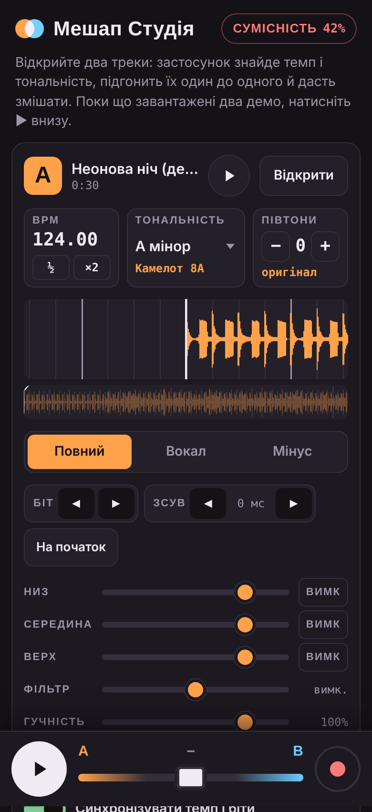
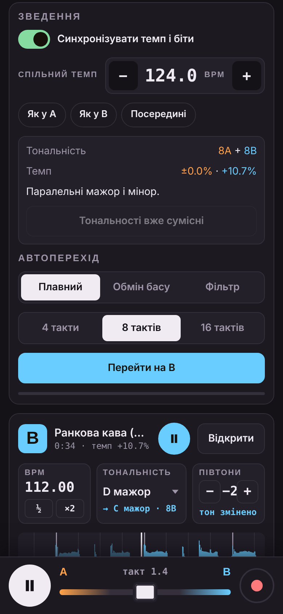
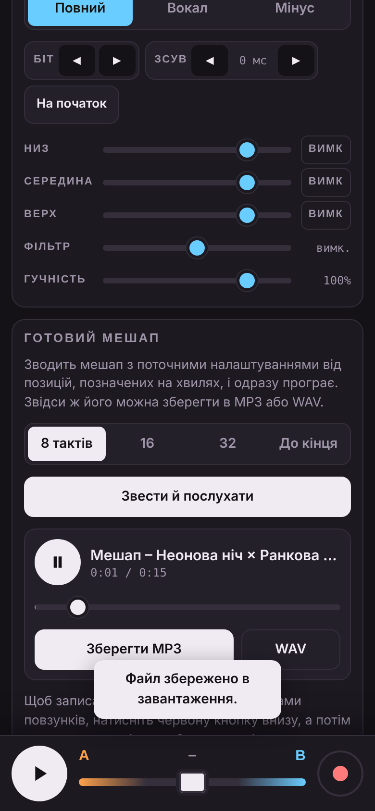

<p align="center"></p>

# Мешап Студія

Android-застосунок для мешапів, натхненний функцією Mix у Spotify. Відкриваєте два треки з телефона, а застосунок знаходить їхній темп і тональність, підганяє один до одного й дає змішати.

<p align="center">  </p>

## Можливості

- **Дві деки, A і B.** Формати MP3, M4A, WAV, OGG, FLAC (до 8 хвилин на трек). Відкритий трек одразу починає грати, поки йде аналіз.
- **Аналіз треку.** Визначає BPM, бітову сітку й тональність з позначенням на колі Камелота.
- **Синхронізація.** Підганяє темп до спільного без зміни висоти тону і вирівнює біти з точністю до долей мілісекунди. Підтримує подвійний і половинний рахунок.
- **Тональність.** Показує сумісність треків у відсотках і пропонує, на скільки півтонів зсунути деку B.
- **Вокал / Мінус.** Кожну деку можна грати повністю, лише вокал або лише мінус.
- **Мікшер.** 3-смуговий еквалайзер з глушінням смуг, DJ-фільтр, гучність, кросфейдер, лімітер на виході.
- **Автопереходи** на 4, 8 або 16 тактів у трьох стилях: плавний, обмін басу, фільтр.
- **Готовий мешап у MP3 або WAV.** Зводиться фрагмент (8, 16, 32 такти або до кінця) чи записується мікс наживо разом із переходами. Результат одразу грає у вбудованому плеєрі, звідти його й зберігаєте.
- **Демо при першому запуску.** Два згенеровані треки, щоб одразу спробувати.

## Встановлення

1. Завантажте **[MashupStudio.apk](../../raw/main/apk/MashupStudio.apk)** (версія 1.1). Свіжа збірка з останнього коміту також є в артефактах [Actions](../../actions).
2. Відкрийте файл на телефоні й дозвольте встановлення з цього джерела.
3. Якщо Play Protect попередить, натисніть «Усе одно встановити».

Потрібен Android 7.0 або новіший.

## Як це працює

Інтерфейс і весь звук живуть у `web/index.html`. Android-оболонка в `android/` лише показує його у WebView, відкриває системний вибір файлів і зберігає MP3 чи WAV через системний діалог.

| Частина | Як зроблено |
|---|---|
| Вокал / мінус | Пошук центру стереопанорами в STFT (2048 точок): частоти, однакові в обох каналах, вважаються центром (голос, бас, бочка), решта йде в боки. «Вокал» = центр вище 170 Гц, «Мінус» = боки + центр нижче 170 Гц. |
| BPM і біти | Спектральний потік, автокореляція, тонке підлаштування гребінцевим фільтром. Фаза біта уточнюється за низькочастотними атаками, щоб не плутати бочку з хетами. |
| Тональність | Хромаграма з FFT на 8192 точки, кореляція з профілями Темперлі–Костки–Пейна. |
| Зміна темпу | Сегменти по 60 мс копіюються без змін і зшиваються короткими переходами по 10 мс у місцях найкращого збігу хвилі. Сегменти з долями біта прив'язуються до сітки, тому удари обох дек збігаються. Висота тону окремо змінюється через швидкість відтворення. |
| MP3 | Кодування 192 кбіт/с бібліотекою [lamejs](https://github.com/zhuker/lamejs) у фоновому потоці. |
| Мікшер | Web Audio API: біквадратні фільтри, кросфейдер з обома деками на повну в центрі, лімітер. |

Важкі обчислення йдуть у Web Worker (по одному на деку), тож інтерфейс не зависає.

## Збірка

Android SDK не потрібен, вистачить Java 11+ і `curl`:

```bash
scripts/build.sh                      # підпис налагоджувальним ключем
KEY_PASS=пароль scripts/build.sh      # підпис власним ключем (keys/release.jks створиться сам)
```

Скрипт завантажує [Apktool](https://github.com/iBotPeaches/Apktool) та [uber-apk-signer](https://github.com/patrickfav/uber-apk-signer), копіює `web/index.html` у `android/assets/`, збирає й підписує APK. Результат: `build/MashupStudio.apk`. GitHub Actions збирає APK на кожен пуш у `main`.

Нативний код написаний на smali (`android/smali/`), тому для збірки не потрібні Gradle чи компілятор Java. Іконки генерує `scripts/make_icons.py` (Pillow).

Інтерфейс можна відкрити і просто в браузері: `web/index.html` працює сам по собі, а збереження там іде у звичайні завантаження.

## Обмеження

- Треки зі Spotify та інших стримінгів не підтримуються: вони захищені. Працює лише з вашими файлами.
- Вокал відділяється за панорамою, а не нейромережею. На студійних стерео-міксах результат добрий, але частина барабанів потрапляє у вокал. Моно-записи не розділяються.
- Сильна зміна темпу (понад 12%) може давати чутні артефакти.
- Кодування в MP3 на телефоні йде приблизно в 4–6 разів швидше за тривалість треку, тож довгий мікс зберігається кілька десятків секунд.

## Ліцензія

MIT, див. [LICENSE](LICENSE). Кодувальник MP3 lamejs поширюється за LGPL-3.0 і вбудований у `web/index.html` окремим блоком.
